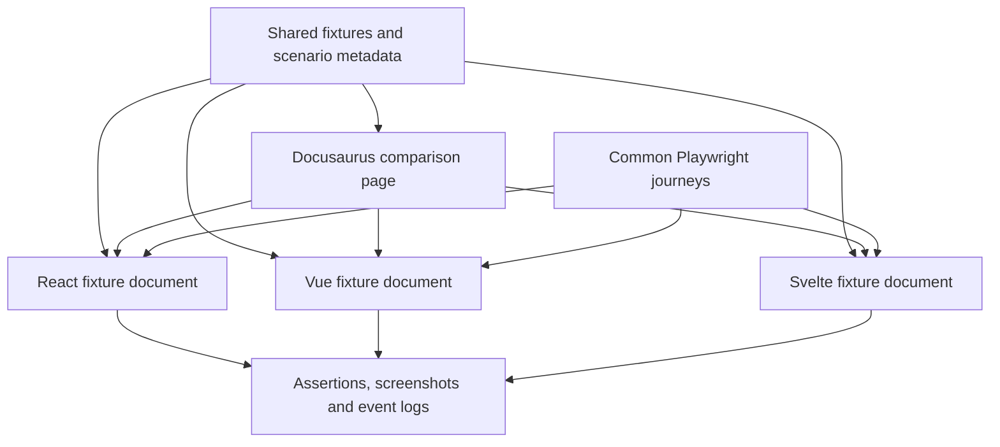

# Framework rendering comparison feasibility

Analysis date 2026-11-17. Source baseline `261a078` on branch
`codex/analyse-comparatif-frameworks`.

The subsequent [implementation plan](./framework-comparison-plan.md) incorporates
the Cloudflare Pages choice, default preview domains and CI gates. The
2026-11-19 revision replaces the daily quota with required reviewer approval
before each publication through a protected GitHub environment.

## Assessment

A shared React, Vue and Svelte comparison page is feasible within the existing
Docusaurus website. All three native renderers already exist, use the same core
display models and distribute identical compiled CSS. The main work is a common
scenario catalogue, isolated browser previews and differential assertions for
rendering and interactions.

PR previews are feasible as a separate delivery step. The current workflows build
and test PRs, while the Pages workflow deploys successful `main` builds. The user
has an existing VPS with Coolify, which was considered for preview delivery.
The subsequent plan selects Cloudflare Pages Direct Upload with default domains
and a trusted GitHub Actions publisher.

This document proposes an implementation and records existing local checks. The
comparison page, differential runner and PR preview pipeline remain proposed work.

## Existing foundations and gaps

| Area | Repository evidence | Consequence |
| --- | --- | --- |
| Native packages | `packages/discord-ui`, `packages/discord-ui-vue`, `packages/discord-ui-svelte` | Each column can exercise the actual public framework package |
| Shared contracts | `packages/discord-ui-core/src/index.ts` and `src/model/` | Share serializable messages, channel data, selections, themes and callback context |
| Shared styling | All four built `dist/styles.css` files have the same SHA-256 after the local build | Differences can still originate in markup, attributes, runtime state and layout |
| Vue SSR comparison | `packages/discord-ui-vue/tests/render.test.ts` | Eight shared message fixtures × three themes compare normalized text with React |
| Svelte SSR coverage | `packages/discord-ui-svelte/tests/render.test.ts` | Export/prop coverage, deterministic SSR and targeted content assertions exist |
| Browser interaction coverage | `tests/website/vue.spec.ts`, `svelte.spec.ts` and feature-specific React specs | Reuse the existing behavioral expectations when defining common journeys |
| Framework mounting | `VueExample.tsx`, `SvelteExample.tsx` and native example entry modules under `apps/website/src/` | Docusaurus already hosts native Vue/Svelte examples through generated bundles |
| Build tooling | `scripts/workspace/generate-vue-examples.mts`, `generate-svelte-examples.mts` | Vite compilation of native examples already runs before website builds |
| Browser CI | `playwright.website.config.mts`, `.github/workflows/ci.yml` | Chromium runs at 1536 × 1024 and 390 × 844, with reports and failure traces |
| Deployment | `.github/workflows/pages.yml` | Publishes the exact tested website artifact from successful main CI |

The Vue text comparison removes all whitespace. It cannot detect spacing,
structure, focus, geometry or most accessibility differences. Svelte's SSR suite
does not directly compare the same rendered fixtures with React or Vue.

The current framework documentation examples also use different data and
interactions. For example, Vue's interaction demo contains a standalone topics
menu and a Wave action, while Svelte's demo embeds its topics menu in a V2 poll.
Placing these examples beside each other would not establish rendering parity.

Existing screenshot calls mostly write inspection images to `/tmp`.
`transparency.spec.ts` inspects image pixels for a specific transparency check.
There is no shared three-framework visual comparison suite or screenshot baseline
suite in the inspected package and website tests.

## Proposed comparison page

Add `/compare` to `apps/website`. Keep its catalogue and framework source modules
in that application, with common synthetic data under `fixtures/comparison/`.

```text
Scenario [Components V2]   Theme [Ash]   Locale [en-US]   [Reset all]

React                  Vue                    Svelte
390 × 844              390 × 844              390 × 844
[Expand to desktop]    [Expand to desktop]    [Expand to desktop]
+------------------+   +------------------+   +------------------+
| Native renderer  |   | Native renderer  |   | Native renderer  |
|                  |   |                  |   |                  |
+------------------+   +------------------+   +------------------+
Events and state       Events and state       Events and state
```

- Show three equal 390 px browser viewports side by side by default. Keep their
  height identical so scroll and wrapping differences remain visible.
- On a narrow host screen, use a labeled, keyboard-scrollable comparison region
  with horizontal overflow. Preserve each preview's width and keep the document
  itself within the host viewport.
- Expand one preview to a 1280 px desktop viewport and provide a return action.
  On smaller host screens, contain the overflow in the preview region and report
  the actual inner width. Resize the existing frame to preserve its current state.
- Keep focus visible, make expansion keyboard-accessible and restore focus to its
  trigger on return. If expansion uses a modal, support Escape and modal focus.
- Apply scenario, theme, locale, media policy and reset controls to all three
  previews. Manual clicks, selections and composition remain independent per
  preview so an individual discrepancy can be explored.
- Display each preview's native callback events and observable state. A loaded
  example has a loading status, while an automated test result needs a separate
  run identifier and result. Keep those statuses distinct in the interface.
- Provide a searchable scenario list and mount only the selected scenario's three
  previews. A large catalogue should not mount every demo simultaneously.
- Encode the selected configuration in the URL, for example
  `/compare?scenario=select-menus&theme=ash&width=390&focus=all`. Include the
  scenario, framework and reproducible step in a failure link.

The page supports manual exploration and shared configuration controls. The
automated comparison runs in Playwright on every PR and uses the same fixtures.
It can also run locally. Replaying a callback alone would bypass the native
interaction being tested.

## Rendering architecture

Use one standalone iframe document per framework, generated into
`apps/website/static/generated/comparison/`. The existing Vite generators provide
the pattern for compiling React, Vue SFCs and Svelte sources into these assets.
The comparison stays part of the website build and routing.

Each document should import its public package and that package's compiled CSS,
with the same minimal document styles, font configuration and viewport metadata.
An iframe provides a genuine inner viewport and isolates Docusaurus styles, root
font sizing and framework-generated IDs. The existing CSS already uses container
queries around 480 px and 640 px, so check both viewport and container dimensions.



Keep mount, update, reset and teardown framework-specific. Share fixture data and
expected outcomes, while each renderer owns its hooks, refs, slots, snippets and
native event binding. Use existing callback contracts such as
`ComponentInteractionContext` to compare message and component identity.

For page controls and event logs, use a small typed frame-message protocol with a
version, preview identity and configuration revision. Validate message source,
origin and shape, and acknowledge readiness after applying configuration. Wait
for all three previews to acknowledge the same revision before capturing them.
Reset local state explicitly, and tear down each native root when its document is
discarded. A frame runtime error must be surfaced to the page and fail its tests.

## Initial scenario catalogue

| Scenario | Rendered states and interaction checks |
| --- | --- |
| Classic messages | Authors, timestamps, edited markers, ephemeral dismissal and unavailable replies |
| Markdown | Whitespace, nested lists, links, mentions, timestamps and opt-in highlighting |
| Embeds | Inline fields, thumbnails, long content and narrow wrapping |
| Files and media | Galleries, failed loads, blocked media, allowlists and fallback labels |
| Spoilers | Text, media and files, pointer/keyboard reveal, hide and focus |
| Components V2 | Containers, sections, accessories, separators and action rows |
| Buttons | Normal/disabled/link/premium actions and message/component callback identity |
| Select menus | All five kinds, keyboard navigation, filtering, Escape, min/max and disabled updates |
| Selection ownership | Defaults, explicit empty controlled values, local values and identity replacement |
| Reactions | Toggle, count, pressed state and externally supplied updates |
| Channel composer | Enter, Shift+Enter, empty input, composition, send callback and reading position |
| Threads and commands | Open/close/focus return, narrow thread layout, command arguments and submit payload |

Start with Light/Ash/Dark and widths 390/1280. This gives 216 initial render
configurations for 12 scenarios across three frameworks. Interaction checkpoints
add captures. Add custom-theme inheritance and localization cases to the relevant
scenarios, and target widths 480/481 and 640/641 around the existing breakpoints.
Use smaller focused fixtures when a combined scenario obscures a failing step.

## Detecting discrepancies

### Automated PR check

Add a dedicated differential suite to the existing browser CI job, with fixtures
served from the tested website build. Run it independently of preview deployment.
One test owns a scenario, theme and viewport, and opens the three native renderers
with the same input. At each checkpoint it collects observable state, callback
events and screenshots, then performs expected-result and pairwise assertions.

For example, a multi-select journey should perform these steps in every frame.

1. Load the same message with an explicitly empty controlled selection.
2. Assert the placeholder and an empty event log, then capture the initial state.
3. Focus the combobox, press ArrowDown and assert the open listbox and active option.
4. Press Enter and assert the expected selected value, message/component context
   and a single selection callback.
5. Press Escape and assert a closed listbox and focus on the combobox.
6. Apply an external controlled-value update and assert that the visible value
   changes without emitting an extra user-selection callback.
7. Capture each stable state and compare React/Vue, React/Svelte and Vue/Svelte.

An assertion failure returns a failing test exit code. Once the initial visual
tolerances are calibrated, this suite should feed the existing `CI / Required`
check so a discrepancy can block merging. Attach expected/actual state, native
events, the three images, pairwise diff images and a reproducible scenario URL
to the Playwright report. Keep a corrected retry visible as a flaky result.

Maintain reviewed screenshot baselines to detect a shared regression across all
three implementations. Pairwise equality alone would accept three equally broken
renderers. Separate expected interaction assertions cover that failure mode for
behavior. The manual page provides a place to investigate a reported difference.

### Behavioral contracts

Use one parameterized Playwright journey per scenario, scoped to a preview frame.
Resolve controls through roles and accessible names. Exercise real pointer and
keyboard actions, then assert the expected outcome independently in every
framework.

Compare callback payloads, event order/count, selected values, `aria-pressed`,
`aria-expanded`, disabled states, focus, message additions, thread state and
reading position at explicit checkpoints. Cover controlled host updates as well
as local component state. Normalize generated IDs consistently and check their
label/control relationships.

### Rendered output

Capture the same fixture bounds and viewport after each stable checkpoint. Keep
diagnostic panels outside the captured area. Compare all three pairs within the
same CI run and save a PNG diff, changed-pixel count and dimension differences.
Cross-framework comparison identifies divergence without treating React as the
authority. Independent expected assertions catch a defect shared by all three.

Use public image comparison dependencies such as `pixelmatch` and `pngjs` as
explicit development dependencies if implementing arbitrary buffer comparisons.
Playwright's screenshot assertions can separately maintain reviewed baselines for
regressions over time. Its internal comparator implementation should not become
a repository dependency. Playwright documents its screenshot assertions and
comparison options in its [visual comparison guide](https://playwright.dev/docs/test-snapshots).

Calibrate a small explicit tolerance with repeated runs. Report every difference
initially, then make stable cases blocking. Track accepted differences by
scenario and reason. Avoid broad masks over controls or text. A baseline update
requires reviewing the images and does not resolve a behavioral failure.

Compare accessible roles, names, values and relationships at key checkpoints in
addition to pixels. Keep HTML normalization limited to known framework artifacts
such as hydration comments and generated IDs, preserving semantic whitespace.

### Determinism

Fix timestamps, `referenceTime`, locale, time zone, fixture IDs, viewport, device
scale, color scheme and reduced-motion settings. Use identical local assets and
fonts in each document. Include native emoji fallbacks as their own explicit case.
Wait for fonts, image decoding and framework readiness. Treat blocked-media and
failed-media cases explicitly. Keep the screenshot environment consistent across
baseline creation and verification, following the
[Playwright environment guidance](https://playwright.dev/docs/test-snapshots).

SSR comparisons and hydration tests remain separate checks. The proposed iframe
page primarily exercises native client rendering. Existing packed-consumer
hydration checks in `scripts/compat/vue-package.mts` and `svelte-package.mts`
should remain part of distribution validation.

## PR preview delivery

### Current pipeline

PR CI already uploads `browser-builds` with the website and package output, then
downloads it for browser tests. Browser reports are separate artifacts produced
after the build. These downloads provide inspection material, but an interactive
preview needs an HTTP hosting destination.

The Pages deployment is restricted to successful push/manual CI runs on `main`.
The public `actions/deploy-pages` documentation still marks its preview input as
an unavailable alpha. Extending the current job with `preview: true` is therefore
not a supported delivery plan. See the
[action's documented inputs](https://github.com/actions/deploy-pages#inputs).

### Proposed delivery contract

Use a static preview destination with an isolated root URL per PR and an immutable
URL or deployment identifier per tested commit. This accommodates the current
Docusaurus `baseUrl: "/"`. Record the tested SHA and CI run ID beside the preview
URL, and only mark that revision successful after its required checks pass.

Deploy the tested build artifact. A trusted publishing workflow can add the
comparison result manifest and images produced by the browser job for that same
run. Validate repository, PR, SHA, run and artifact identity, and avoid executing
PR code in the publishing job with write credentials. Handle fork PRs explicitly
through an approved publishing policy and read-only build jobs.

Expose the URL through a deployment/check result, with a PR comment only if that
publication is authorized. Define cleanup on PR close, retention and a guard
against an older run replacing the latest successful preview. Use a preview
origin separate from production and configure preview pages for no indexing.

If previews must use subpaths on a shared Pages site, budget for an aggregate
deployment preserving every live PR plus production, serialization and cleanup.
The current Pages artifact replaces the published site. Docusaurus `url` and
`baseUrl` also need preview-aware configuration, and root-relative references in
the Vue SSR generator, assets and tests need an audit. Docusaurus describes this
path handling in its [configuration reference](https://docusaurus.io/docs/api/docusaurus-config#baseUrl).

### Existing VPS with Coolify alternative

Coolify documents PR previews with per-preview domains and automatic cleanup of
automatically created previews when the PR closes. It also supports Docker Image
previews and API-driven creation with a selected image tag. Confirm these
capabilities against the installed version. See the
[Coolify preview documentation](https://coolify.io/docs/applications/deployments/preview-deployments).

Use GitHub Actions to build and test, then package the tested static output and
comparison report into a serving image identified by the tested SHA. Publish it
and request a Coolify preview using that immutable tag. The VPS serves the result,
while browser tests run on the existing CI runners. This follows the documented
[Coolify image-based GitHub Actions flow](https://coolify.io/docs/applications/sources/github/actions).

Use a domain template such as `{{pr_id}}.preview.example.com`, with wildcard DNS
pointing at the VPS and verified HTTPS. Validate preview creation, replacement and
cleanup for API-created image previews explicitly. Automatic cleanup documented
for Git-triggered previews does not establish that custom CI lifecycle behavior.
See the [domain and lifecycle documentation](https://coolify.io/docs/applications/deployments/preview-deployments).

The remaining setup inputs are the Coolify version, application identity, domain,
registry access, available capacity and deployment permissions. Creating a preview
or changing its Docker tag requires API write permission in the current docs.
Keep deployment credentials in the trusted publishing path. See the
[preview API permission notes](https://coolify.io/docs/applications/deployments/preview-deployments#manage-previews-through-the-api).

## Implementation sequence and effort

These are engineering estimates for one contributor familiar with the repository.
They exclude investigation and correction of renderer defects uncovered by the
new comparison.

| Increment | Deliverable and acceptance | Estimated effort |
| --- | --- | --- |
| 1. Vertical slice | Three identical native fixtures, isolated 390 px frames, theme controls, desktop expansion, reset and keyboard focus | 1–2 days |
| 2. Scenario coverage | Twelve scenario families, shared fixture data, event panels, URL state and teardown checks | 2–3 days |
| 3. Differential CI | Common journeys, pairwise image diffs, expected-state assertions and linked artifacts | 2–3 days |
| 4. PR delivery | Tested-artifact preview publishing, SHA metadata, fork policy, race handling and cleanup | 1–2 days after hosting access |

Total estimate is 6–10 working days, subject to the vertical slice confirming
frame bundling and stable captures. Measure build duration, bundle size and
comparison duration in that slice before expanding the matrix. The current
browser job has a 20-minute timeout, two CI workers and two retries. Use a small
blocking smoke matrix first and extend coverage after observing its runtime.

Acceptance should include deliberately introducing a temporary markup defect and
an incorrect callback/focus result, proving that the corresponding differential
checks fail, then reverting those mutations. Also verify direct route reloads,
frame readiness failures, resets after interactions, preservation on resize,
Light/Ash/Dark and narrow host navigation.

## Local evidence

- Node `v26.13.1` and pnpm `12.16.1` match the declared toolchain.
- `pnpm build:lib` passed for the shared core and all three renderers.
- The four compiled CSS outputs have identical SHA-256 hashes.
- `pnpm exec vitest run packages/discord-ui-vue/tests/render.test.ts packages/discord-ui-svelte/tests/render.test.ts`
  passed with 40 tests across two files.
- `pnpm build:website` passed, including native example generation and the
  production Docusaurus build.
- `pnpm exec playwright test -c playwright.website.config.mts tests/website/vue.spec.ts tests/website/svelte.spec.ts`
  passed with 24 tests in Chromium across the configured desktop and narrow
  viewports. These cover existing framework examples and fixtures, including
  menus, reactions, threads, composition, commands, themes and focus behavior.
- The first browser attempt exhausted the local server's Node heap inside the
  restricted sandbox before tests started. The same command passed outside the
  sandbox with local server access. The precise cause of the initial heap
  exhaustion was not diagnosed.

These checks establish existing package and fixture behavior. Differential
three-framework results, remote PR deployment, real Discord integration and
cross-browser/device coverage require their own validation.
