# Framework comparison implementation plan

Prepared on 2026-11-17 for branch `codex/analyse-comparatif-frameworks`.
Publication policy revised on 2026-11-19.
The [feasibility study](./framework-comparison-feasibility.md) records the source
inspection and existing local test evidence. This plan incorporates the subsequent
hosting, security and reviewer-approval discussion.

The user reports steps 1–6 as nearly complete. At source revision `10ee97b`, the
comparison lives in the standalone `apps/comparison` Vite app, its tested output
is included in `browser-builds`, and CI runs the comparison in the pinned Docker
environment. The remaining implementation sequence starts with step 7 below,
following final validation of step 6. The earlier step descriptions record the
original design; current application paths and CI artifacts govern integration.

## Target outcome and working decisions

- The standalone comparison app presents native React, Vue and Svelte
  renderings of the same scenario in three 390 × 844 frames.
- A preview can expand to 1280 px while retaining its interaction state.
- Shared Playwright journeys compare rendered images, accessibility state,
  callback events and observable outcomes across the three frameworks.
- GitHub-hosted runners execute PR builds and tests. Cloudflare Pages receives
  the tested static comparison app and comparison evidence through Direct Upload.
- The initial preview domain uses Cloudflare's `pages.dev` URLs, with a stable
  `pr-<number>` alias and a deployment-specific URL recorded against the tested SHA.
- Each preview publication requires explicit approval through the protected
  GitHub environment `comparison-preview`, after the required CI checks succeed.
  This replaces the proposed daily quota with a reviewer decision for each run.
- A separate trusted publisher owns deployment credentials. Preview inputs are
  treated as untrusted static content.
- Approval covers the exact source revision and tested artifact displayed for
  that publication run. The same review gate covers internal and fork PRs.

The environment name and retention below are implementation defaults selected
for this plan. Required reviewers, self-review policy and environment availability
must be configured against the actual repository plan and maintainer team.

## Dependencies and pipeline

```mermaid
flowchart TD
  PR[PR update] --> Checks[Lint and preliminary checks]
  PR --> Unit[Library build and unit tests]
  Checks --> Build[Website build, types and package checks]
  Unit --> Build
  Build --> Browser[Website and differential browser tests]
  Checks --> Required[CI / Required]
  Unit --> Required
  Build --> Required
  Browser --> Required
  Dependency[Dependency review] --> Required
  PR --> Dependency
  Required --> Publisher[Trusted publisher validates run and PR]
  Publisher --> Review[Reviewer approves protected environment]
  Review --> Recheck[Revalidate PR revision and artifact]
  Recheck --> Upload[Upload tested static files and report]
  Upload --> Result[Deployment URL and tested SHA]
  Browser --> Artifacts[Diagnostic artifacts on failure]
```

The library's compiled exports are required by existing unit tests. Browser tests
require the production website build. Gate the website build on preliminary
checks, then gate publication on every required check. Preserve the existing
package, type, documentation and dependency-review requirements when reorganizing
the jobs. GitHub documents dependent jobs through
[`needs`](https://docs.github.com/en/actions/reference/workflows-and-actions/workflow-syntax#jobsjob_idneeds).

## Step 1 — Define the shared scenarios and outcomes

### Work

- Create `fixtures/comparison/` with serializable data and stable scenario IDs.
- Define scenario metadata, supported states, expected events and comparison
  checkpoints. Keep executable test journeys in the test suite.
- Fix dates, reference time, locale, time zone, media inputs and generated IDs.
- Reuse existing message, channel and menu fixtures where their content provides
  an identical input across frameworks.
- Start with three small scenarios covering a classic message, V2 interactions
  and a channel with a thread.

### Acceptance

The three native wrappers consume the same fixture data. Expected behavior is
written down independently of any renderer. Classic and V2 model constraints
remain enforced by the current public contracts.

## Step 2 — Build the three isolated fixture documents

### Work

- Extend the existing native example-generation approach under
  `scripts/workspace/`, compiling standalone React, Vue and Svelte entry modules.
- Generate documents and assets into the ignored
  `apps/website/static/generated/comparison/` directory.
- Import each renderer through its public package exports and compiled CSS.
- Supply identical minimal document styles, local assets and font settings.
- Implement native mounting, configuration updates, explicit reset and teardown.
- Add typed ready, configuration-applied, event and error messages. Check frame
  identity, message shape and configuration revision before accepting them.
- Expose stable semantic targets and readable event/state output to Playwright.
- Integrate generation into the current website dev/build flow and verify source
  updates regenerate the relevant fixtures during development.

### Acceptance

All three documents load directly from the production build, use identical input
and acknowledge applied settings. Reset clears local demo state and event logs.
Mounting and teardown remain reliable through repeated scenario changes.
An exception produces an explicit failed state for the page and browser tests.

## Step 3 — Implement the comparison page

### Work

- Add `apps/website/src/pages/compare.tsx` and focused comparison components.
- Show three equal 390 × 844 viewports with framework names and actual dimensions.
- Provide a scenario catalogue, theme and locale controls, shared reset and a
  configuration URL that survives reloads.
- Keep manual interactions independent within each framework's preview.
- Show framework callback events and observable state outside captured regions.
- Expand one existing frame to a 1280 px viewport, preserving its document and
  state. Provide an accessible return action and focus restoration.
- Contain horizontal scrolling within the comparison region on narrow hosts.
- Keep page layout/styles in the website and renderer styles in their packages.

### Acceptance

Verify direct routing, reload, keyboard navigation, visible focus, reset and
expansion/return after an interaction. Inspect all three themes and narrow host
layouts. An unknown query value receives a clear fallback. Loading, local
interaction state and results from an automated run have distinct labels.

## Step 4 — Implement the automated comparison runner

### Work

- Add a differential Playwright spec under `tests/website/`, reusing the current
  website server/configuration and testing each renderer through its frame.
- Run one shared action sequence for each scenario/theme/preview-width tuple.
- Use role/name locators and real pointer or keyboard actions.
- At each checkpoint assert expected state, accessible names and values, focus,
  native callback payloads, event order/count and relevant scroll position.
- Capture identical bounds after framework readiness, fonts and images stabilize.
- Compare React/Vue, React/Svelte and Vue/Svelte image pairs, including dimensions.
- Use explicit maintained image-comparison dev dependencies, initially
  `pixelmatch` and `pngjs`, for arbitrary PNG comparisons.
- Add reviewed screenshot baselines for regressions shared across all renderers.
- Normalize generated IDs consistently while preserving label/control references
  and semantic whitespace in any DOM comparison.
- Keep SSR text/structure and packed-consumer hydration checks as separate layers.

### Evidence per failure

Attach the scenario and checkpoint, expected/actual state, native events, three
screenshots, pairwise diffs, dimensions, changed-pixel counts, trace and a link to
the reproducible scenario configuration. Record the renderer/environment versions
and tested commit with the report.

### Acceptance

Demonstrate failure using temporary markup, callback and focus mutations, then
revert those mutations. Repeat unchanged scenarios to measure visual stability.
Calibrate and record tolerances per justified case. Keep flaky retry information
visible. Playwright describes baseline/environment constraints in its
[visual comparison documentation](https://playwright.dev/docs/test-snapshots).

## Step 5 — Expand coverage in measurable batches

### Work

Expand the first three scenarios into these twelve families.

| Family | Important states |
| --- | --- |
| Classic messages | Author variants, edited marker, ephemeral dismissal, unavailable replies |
| Markdown | Whitespace, nesting, mentions, timestamps, links and optional highlighting |
| Embeds | Fields, thumbnails, long text and wrapping |
| Media and files | Galleries, failures, blocked media, allowlists and fallback labels |
| Spoilers | Pointer/keyboard reveal, hide and focus |
| Components V2 | Sections, accessories, containers, separators and rows |
| Buttons | Disabled, link and premium variants, callback message/component context |
| Select menus | Five kinds, keyboard, filtering, Escape, min/max and disabled updates |
| Selection ownership | Defaults, explicit empty controlled values, identity changes and external updates |
| Reactions | Counts, pressed state, toggling and host updates |
| Channel composer | Empty input, Enter/Shift+Enter, composition, send and reading position |
| Threads and commands | Focus return, narrow layout, arguments, submission and thread state |

Use Light/Ash/Dark and inner widths 390/1280. Add targeted 480/481 and 640/641
boundary cases plus locale/custom-theme variations where relevant. Parameterize
inner viewport widths explicitly so host project widths do not accidentally
duplicate or omit scenarios.

### Acceptance

The base matrix covers 72 scenario/theme/width combinations and 216 native
renders before interaction checkpoints. Measure actual run duration and artifact
size. Split oversized families into focused fixtures. Keep an explicit coverage
table linking every family to assertions and supported checkpoints.

## Step 6 — Integrate CI and result artifacts

### Work

- Add the differential suite to browser CI and include its result in
  `CI / Required`.
- Initially publish visual differences for calibration, then make stable cases
  blocking. Behavioral failures are blocking from the first integration.
- Preserve existing checks and use the exact build artifact consumed by tests.
- Produce a structured report manifest with source PR head SHA, actual tested
  checkout SHA, run ID/attempt, scenario matrix and results. PR merge-checkout
  SHAs must be distinguished from contributor head SHAs.
- Associate runs/artifacts through GitHub API metadata and verified identities.
- Set artifact retention to seven days initially, aligned with publisher needs.
- Keep detailed failure diagnostics downloadable from GitHub when CI fails.
- Measure against the current browser timeout and worker settings, and batch
  scenarios when the measured budget requires it.

### Acceptance

An injected differential failure fails `CI / Required` and retains evidence.
The publishing path accepts a successful fully tested revision. A superseded run
cannot replace a newer PR preview. Build generation is performed once for the
artifact that browser tests and publication subsequently consume.

## Step 7 — Implement the trusted publisher and reviewer approval

### Trusted publication

- Add a dedicated workflow triggered after CI completion, using its definition
  and scripts from the trusted default branch. Handle successful runs only.
- Validate workflow identity, repository, run, PR state, current PR head,
  approval policy, tested commit and artifact identity/digest.
- Resolve PR identity through verified GitHub metadata rather than branch-name
  parsing or an untrusted artifact field alone.
- Use the current PR revision for eligibility checks and retain both head and
  tested merge SHA in deployment metadata.
- Run the trusted publication scripts against validated static artifacts.
- Give Cloudflare credentials only to this publisher and scope its token to the
  preview project/account permissions it requires.
- Apply a static artifact policy. Validate paths and file sizes, reject symlinks
  and server/function entry points such as `_worker.js`, and create deployment
  headers/configuration from trusted templates.
- Render report metadata as data and keep large traces in GitHub artifacts.
- Prepare a review summary with PR, source head SHA, tested checkout SHA, CI run,
  artifact identity and diagnostic links before requesting approval.
- Revalidate the current PR head, required-check result and artifact identity
  after approval, immediately before upload.

GitHub documents both the privileges and untrusted-artifact risks of
[`workflow_run`](https://docs.github.com/en/actions/reference/workflows-and-actions/events-that-trigger-workflows#workflow_run).

### Approval behavior

Split publication into a read-only eligibility job and a protected upload job.
The upload job references the fixed environment `comparison-preview`. Configure
Required reviewers on that environment in repository Settings. A reviewer uses
Review deployments, then Approve and deploy or Reject. Approval permits the
upload job to start and access environment-scoped credentials. A PR review and a
deployment review have separate purposes. See the
[GitHub deployment review flow](https://docs.github.com/en/actions/how-tos/deploy/configure-and-manage-deployments/review-deployments).

- Configure reviewers before enabling the workflow. GitHub can automatically
  create an environment referenced by YAML, so verify its protection settings
  explicitly during setup.
- Select a maintainer or team with repository access. GitHub accepts up to six
  reviewer users/teams and requires one approval from that list.
- Choose self-review behavior deliberately. Enabling Prevent self-review requires
  a different eligible person from the initiator to approve the run. A sole
  maintainer needs a policy that allows them to approve their own publication.
- Configure administrator bypass to match the intended approval requirement, and
  store the Cloudflare token in the protected environment.
- Gate preview publication after `CI / Required` succeeds. Validation and its
  reports complete before the publication review is requested.
- Deduplicate a revision that already has a verified successful deployment.
- Use per-PR concurrency to cancel superseded publication runs, including waiting
  approvals, and verify eligibility again before changing the PR alias.
- A new source commit creates a new publication run and review request. Retain
  the reviewed artifact identity for the lifetime of each run.
- Treat rejection, cancellation, stale revisions, expired artifacts and provider
  failures as explicit publication outcomes. A fresh publication run requires
  its own protected-job approval, including manual reruns that reach that job.
- Preserve the last validated preview URL and displayed SHA while a newer
  revision is awaiting approval or its publication fails.
- Keep environment protection and deployment-result records as the approval audit
  trail. The protected job's first trusted step rechecks eligibility after waiting.

Environment protection is configured in GitHub Settings separately from the YAML
reference. On GitHub Free, Pro and Team, Required reviewers are available for
public repositories; private/internal availability requires checking the actual
Enterprise plan. Confirm visibility and feature availability before implementation.
See [environment setup and availability](https://docs.github.com/en/actions/how-tos/deploy/configure-and-manage-deployments/manage-environments).

Manual approval controls publication frequency through reviewer decisions. Usage
monitoring remains part of step 9 for provider and GitHub compute/storage costs.

### Acceptance

Test approval, rejection, cancellation, retry, duplicate events, approval after a
new commit, a PR closed during review, expired artifacts and an interrupted
upload. Exercise simultaneous PRs and stale-run alias updates. Verify protected
credential access and hostile artifact/configuration rejection. Demonstrate that
the upload waits for the configured reviewer and the current tested revision.

## Step 8 — Connect Cloudflare Pages

### Setup inputs

- A Cloudflare account and a dedicated Pages preview project created in Direct
  Upload mode.
- Account ID, project name and a narrowly scoped API token stored in the trusted
  publishing environment.
- The `comparison-preview` GitHub environment with configured Required reviewers,
  an agreed self-review/bypass policy and its scoped Cloudflare credentials.

Direct Upload accepts prebuilt assets. Its project mode should be selected during
creation because Cloudflare documents restrictions on switching between Direct
Upload and Git integration. See the [Direct Upload guide](https://developers.cloudflare.com/pages/get-started/direct-upload/).

### Work

- Use the `cf` CLI with a pinned trusted version and the already-tested
  `apps/comparison/dist` directory. Discover commands through CLI help/schema
  during implementation. A target project with a Wrangler configuration follows
  the repository's documented tooling exception.
- Deploy each PR as a synthetic `pr-<number>` preview branch.
- Record the returned immutable deployment URL and stable PR alias in a GitHub
  deployment result with the exact tested revision.
- Verify the comparison app root, direct fixture URLs, local assets, refresh and report access
  on the returned deployment-specific URL before marking publication successful.
- Add preview `noindex` headers through the trusted publication configuration.
- Use Cloudflare's default domains initially. Custom wildcard domains are outside
  Pages' supported custom-domain behavior. See its
  [wildcard limitation](https://developers.cloudflare.com/dns/manage-dns-records/reference/wildcard-dns-records/).

### Acceptance

One successful PR receives a working preview, subsequent successful revisions
update its alias, and the recorded deployment URL continues to identify the
tested build. Failed tests leave their diagnostics in GitHub. Waiting/rejected
publication reviews produce an explicit status linked to the exact revision.

## Step 9 — Verify lifecycle, costs and maintenance

### Work

- Add trusted cleanup for closed PRs and a scheduled reconciliation of abandoned
  previews. Verify that an upload in progress cannot recreate an obsolete preview.
- Retain the latest successful deployment for each open PR. Initially retain
  superseded deployments for seven days and remove closed-PR previews within a
  day, subject to the provider's deletion constraints.
- Keep seven-day diagnostic artifacts, then review storage using real report sizes.
- Track waiting/approved/rejected publication reviews, successful/failed uploads,
  CI runtime, storage and provider errors.
- Document local commands, report interpretation, baseline review, accepted
  differences, token rotation, reviewer setup, retries and cleanup recovery.
- Review Cloudflare usage, CI compute and report storage with the observed
  publication frequency. Reviewer approval is a publication gate; build and test
  consumption occurs earlier in the pipeline.
- Provide the final validated URL and run IDs as implementation evidence.

### Acceptance

Exercise PR creation, update, failed validation, approval/rejection, rerun, closure
and stale-event handling end to end. Verify cleanup against the dedicated preview
project and its open PR inventory. Classify Chromium narrow-viewport evidence
separately from physical mobile, other browsers and real Discord integration.

## Delivery batches and effort

| Batch | Steps | Reviewable result | Estimate |
| --- | --- | --- | --- |
| A | 1–3 | Local comparison page with three initial native scenarios | 2–3 days |
| B | 4–5 | Automated journeys, pairwise differences and twelve scenario families | 3–4 days |
| C | 6–7 | CI integration, trusted publisher and protected-environment approval | 1–2 days |
| D | 8–9 | Live previews, lifecycle checks and maintainer instructions | 1–2 days |

The original whole-project estimate is historical following progress on steps
1–6. Remaining steps 7–9 are estimated at 2–4 contributor working days once step 6
is validated, excluding account/repository setup delays and uncovered defects.
Reassess after verifying environment availability and the trusted upload tooling.

Each batch should be reviewable before expansion. Run targeted tests during
development, then the appropriate website/build/type checks at integration.
Changes to public contracts or distribution require their existing consumer
verification. Documentation-only planning uses reference, formatting and ignore
checks.

## Completion checklist

- [ ] Three native renderers receive identical fixtures.
- [ ] Three narrow previews and desktop expansion work with keyboard access.
- [ ] Twelve scenario families have explicit outcomes and interaction checkpoints.
- [ ] Visual, behavioral and accessibility-state differences produce inspectable evidence.
- [ ] Mutation checks prove that intended regressions fail the suite.
- [ ] Required CI gates publication of the exact tested build.
- [ ] Trusted publication handles PR/fork identity and hostile artifact inputs.
- [ ] Protected-environment approval covers the exact tested revision and artifact.
- [ ] New commits, rejection, reruns and stale approvals have verified behavior.
- [ ] Default-domain PR previews expose both alias and revision-specific URLs.
- [ ] Waiting/rejected/failed publications retain an explicit status and previous SHA.
- [ ] PR closure, retention and reconciliation work end to end.
- [ ] Final evidence records actual local and remote checks with remaining limitations.
